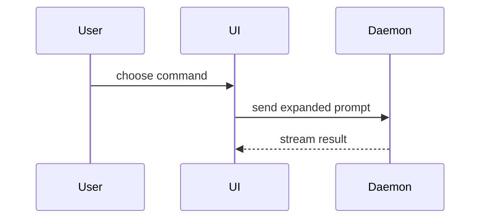

Write the body of a pull request in this thread's repository.

## Find the change

Call `playbookRepositories`, unless the prompt already names this thread's repository. With several allowed, ask the person who started the thread which one, in one line, and wait.

The person names the pull request by its number, or a branch that has none yet. When they named neither, list the open ones with `repoMergeRequests` and ask which. Read the pull request with `repoMergeRequest` and its patches with `repoMergeRequestDiff`; for a branch without one, use `repoCompare` against the default branch. Read the checks of its head with `repoChecks`, and the end of a failed job's log with `repoJobLog`.

## Template

Use this template for the body:

```markdown
## Summary

<diagram, diff-sketch, or tree>

## Evidence

- **Before:** <screenshot/output/failing test run>
  **After:** <screenshot/output/passing test run>

## Merge Danger

**Door:** <one-way or two-way>

<optional: description>

**Blast Radius:** <one-word description>

<optional: potential ramifications of merge>
```

## Sections

Skip all preambles and keep prose brief. Use the team's domain language from `GLOSSARY.md` in the repository (read it with `repoReadFile` when it exists).

### Summary

Pick the smallest view that makes the key point clear.

- Show logic or an algorithm as pseudocode:

```text
on(save)
  if content is unchanged
    return cached result
  write new content
  return fresh result
```

- Show runtime control flow as a call tree:

```text
submitForm
  createSession
    persistPrompt
    launchAgent
  navigateToSession
```

- Show UI structure as a component tree, including state and module boundaries that matter:

```text
<SessionPage> (apps/example/src/routes/session.tsx)
  useSessionEvents()
  <SessionToolbar>
    <RunSkillButton> (packages/ui)
```

- Show file responsibility or a broad refactor as a shallow file tree:

```text
src/
├── commands/       # parses user actions
├── sessions/       # owns session state
└── transport/      # sends API requests
```

- Show component interaction, control flow, or data flow with Mermaid:



- Use `diff` when the point is what changes and the surrounding shape already exists. Match the diff shape to the topic.

For a component change:

```diff
 <SessionPage>
   useSessionEvents()
   <SessionToolbar>
+    <RunSkillButton />
   <SessionTimeline>
+    <SkillResultCard />
```

For a file-layout change:

```diff
 src/
 ├── commands/
+│   └── show-me.ts       # expands the slash command
 ├── sessions/
-└── transport.ts
+└── transport/
+    ├── client.ts
+    └── stream.ts
```

For a call-tree or call-stack change:

```diff
 submitForm
   createSession
     persistPrompt
+    expandSkillMention
     launchAgent
-  navigateToSession
+  navigateToSession
+    subscribeToEvents
```

For a state or control-flow change:

```diff
 on(save)
-  write content
+  if content is unchanged
+    return cached result
+  write new content
+  invalidate cache
```

- Show the whole block when most of it is new, when omitted context would hide ownership or order, or when the reader needs a copyable target shape:

```ts
function expandSkill(command: string): string {
  const skillName = command.slice(1);
  return `use the ${skillName} skill`;
}
```

#### Guidance

Place each visual next to the short text it supports. Keep only the calls, files, props, states, and boundaries needed to answer the reader's current question or the options to resolve the current discussion point.

You may use one of these, you may use several, it is unlikely you will use all of them. Use your judgement and don't overwhelm the reader.

### Evidence

Concrete evidence that the change works. Show a before and after.

You cannot take screenshots or run anything. Your evidence is what the repository already holds: the checks on the head commit and their job logs, and the tests the change adds or changes, shown as the exact test that failed before and passes now, in pseudocode. When a screenshot would be the best evidence, leave a placeholder line asking the author to add one.

### Merge Danger

Describe whether it's a one-way or two-way door. You can walk back through two-way doors, but not one-way doors. A pull request that is cheap to roll back is lower risk. Changes that involve destructive actions or hard-to-reverse decisions are one-way doors.

The blast radius is the potential impact or scope of the changes introduced by this pull request. Consider all possibilities. Examples are layout shift, breakages for consumers, mobile responsiveness, etc.

## Put it on the pull request

Do not post the whole body in the thread: a Discord message holds 2,000 characters. Post a preview under 1,500 characters (the Summary view and the door), then set the body with `repoUpdateMergeRequest`; for a branch without a pull request, open one with `repoOpenPullRequest` and the body. Either waits for a Confirm. Changes they ask for afterwards go in as a new `repoUpdateMergeRequest` with the whole body.
